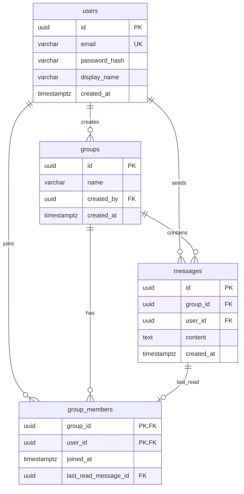

# データベース設計

## ER 図

## テーブル説明

### users
ユーザーアカウント。パスワードは bcrypt ハッシュで保存。

### groups
チャットグループ。作成者は自動的にメンバーになる。

### group_members
グループとユーザーの多対多。`last_read_message_id` で既読位置を管理。

### messages
グループ内のメッセージ。時系列で取得するため `(group_id, created_at)` にインデックス。

## 既読の仕組み

メッセージごとに既読レコードを作るのではなく、**メンバーごとに最後に読んだメッセージ ID** を保持する方式を採用。

- ユーザー A がメッセージ M を読んだ → `group_members.last_read_message_id = M.id`
- 他メンバーへ WebSocket で `read_receipt` を broadcast
- UI 側で「自分より後のメッセージを読んでいるか」を判定

## スキーマファイル

初期化 SQL: `api/src/db/schema.sql`  
Docker Compose 起動時に自動適用される。
